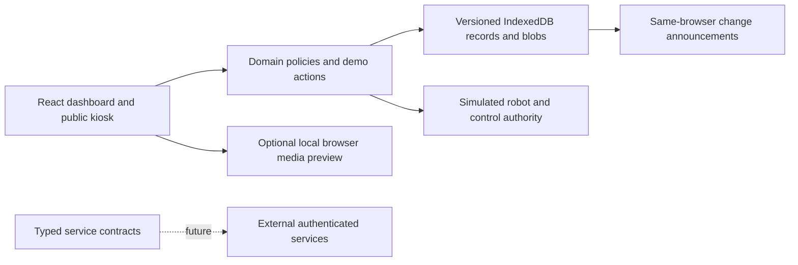
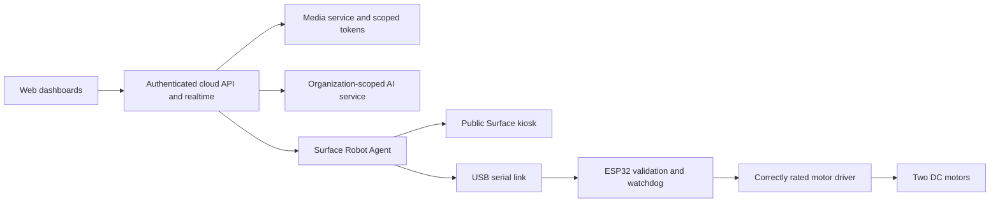

# Architecture

Feedar is a public, static browser demonstration. It has no production credentials, network robot control, server process, or paid dependency. The existing application in the parent repository remains separate; this package does not replace its backend or connect to its services.

## Browser implementation

React and strict TypeScript render the approved dark dashboard, standalone welcome/login, and public kiosk. React Router uses hash routes, which survive direct navigation and refresh on GitHub Pages. Shared domain operations enforce default-deny role, tenant, assignment, and lifecycle rules. Components request operations through the demo provider rather than modifying records directly.

IndexedDB stores versioned records and validated image blobs. Small visual preferences may use localStorage; the selected fictitious identity is tab-scoped. Same-origin BroadcastChannel announcements refresh other tabs, while transactional IndexedDB operations provide exclusive simulated driving leases. BroadcastChannel itself is not a lock. No password or media stream is stored in the database.

Storage, permissions, simulator, UI, media, and future service interfaces are separate modules. Local operations can fail with permission, validation, lifecycle, unavailable storage, or conflict errors. Corrupted/unsupported storage displays a recovery path. Reset restores deterministic fixtures after stopping simulation and media. The provider uses local records for counts so the platform and tenant KPIs describe the same data.

## Boundaries

Working local features include navigation, CRUD, forms, role demonstrations, invitation redemption, map/POI management, persisted chat, knowledge, support tickets, audit filtering, and CSV export. Simulation covers robot telemetry/motion, remote camera/call participants, AI replies, pairing, releases, firmware updates, email outbox, MFA, and access leases. Local camera/microphone, screen capture, speech synthesis, and fullscreen depend on browser support and explicit permission. Preview media is never transmitted by this static demo.

Frontend policy is a demonstration, not production tenant isolation. Browser data and audits can be edited or deleted by the browser owner and are not tamper-proof. Dynamic invitations are only available in the same browser profile/origin; an unknown record in another browser must remain unavailable. Seeded public tours are available after a fresh-browser seed.

## Future production separation

The cloud needs secure identity/MFA, PostgreSQL with server-enforced tenant policies/RLS, scoped object storage, and WebSocket/MQTT where appropriate; Redis is optional infrastructure. Every endpoint, subscription, uploaded object, device command, and media token must be authorized on the server. Secrets and token minting remain off the frontend.

A separate C#/.NET Surface agent or equivalent owns device credentials, authenticated cloud connectivity, health, serial communication, local safety supervision, cache, startup/recovery, and signed updates. Public kiosk rendering must be separated from privileged control. Local IPC/loopback bridges require authenticated messages, origin restrictions, and process isolation. Never expose an unauthenticated local motor-control API.

An ESP32 implementation, rated driver, actual sensors, and independent physical safety system are external work. Browser timer behavior, simulated integration, and passing software tests cannot validate a physical robot around people.
