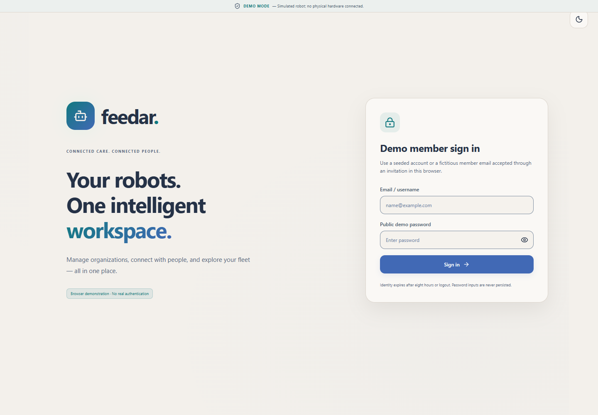
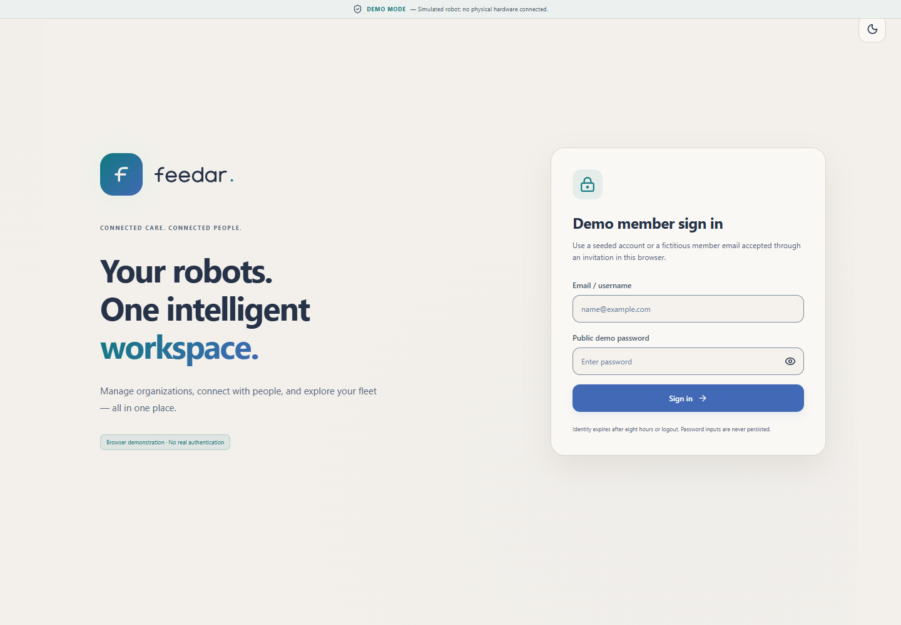
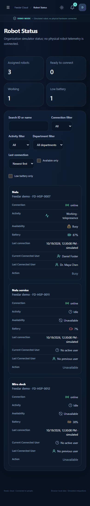
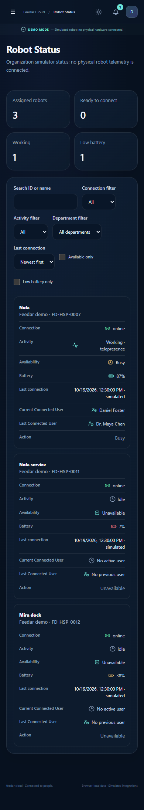

# Feedar v1 SVG integration

Sixteen reviewed SVG sources are stored at their canonical paths under `src/assets/`. Their bytes match the source package. `ASSET_V1_SOURCES.json` records their IDs, paths and SHA256. There is no runtime or build dependency on the external design package.

`FeedarAsset` renders generated React JSX from those files. Run `node scripts/generate-feedar-assets.mjs --check` to verify reproduction; regenerate with the same command without `--check` only after an authorized source change. The generator accepts a fixed list of local files and a restricted SVG shape/attribute grammar. It removes internal titles/descriptions for decorative reuse and supports battery segment opacity and ticket group visibility. It introduces no scripts, external references, raster images, fonts, instance IDs or raw HTML rendering. Git attributes preserve the canonical bytes and generated line endings on Windows.

The existing brand tile, font metrics, spacing and responsive containers remain in place. Hidden, aria-hidden legacy text measures the wordmark's footprint; the displayed wordmark is the new vector. Organization logos remain independent. Vectors are decorative by default; a `label` gives a standalone semantic vector an accessible name. The new asset CSS does not mirror vectors or add continuous animation.

## Real consumers

All paths below are relative to `src/assets/`; routes are existing hash routes with the existing access guards.

- `brand/feedar-symbol.svg`: shared FeedarMark on welcome/login, Shell and public headers; initial provider loading tile; existing kiosk brand tile.
- `brand/feedar-wordmark.svg`: shared FeedarMark and kiosk wordmark.
- `icons/navigation/nav-robots.svg`: Robot Management/Robots navigation and existing robot entity summaries, registry/fleet rows and pairing wizard.
- `icons/robot-status/robot-online.svg`: actual connectivity in organization status/management, Boss monitoring, overview and session.
- `icons/robot-status/robot-offline.svg`: the corresponding actual offline branches.
- `icons/robot-status/robot-available.svg`: existing control-status availability on `/org/status`, `/robot-monitoring` and session.
- `icons/robot-status/robot-busy.svg`: existing Busy branch on those routes.
- `icons/robot-status/robot-unavailable.svg`: existing Unavailable branch on those routes.
- `icons/robot-status/robot-battery.svg`: actual capacity in organization status, monitoring and fleet; existing low-battery branch retains its caller's warning tone.
- `icons/robot-status/robot-charging.svg`: existing charging branch on organization status.
- `icons/robot-status/robot-critical-battery.svg`: existing critical branch on organization status.
- `icons/robot-status/current-connected-user.svg`: existing active-controller identity; pending/no active user keeps the idle glyph.
- `icons/robot-status/last-connected-user.svg`: existing last-controller field, including its existing no-history label.
- `icons/notifications/notification-bell.svg`: Shell Notifications button and the existing notification/request list bell locations; existing count and actions remain.
- `icons/support/ticket-status-badge.svg`: organization and Boss ticket tables; the actual five visual states, with `new` as the existing open alias.
- `illustrations/empty-states/shared-empty.svg`: shared data-absence states, including filtered robot results and empty ticket history. Error, success and missing-workspace states keep separate glyphs.

Status selectors and callers continue to own meaning. Organization battery priority remains charging, below 10 critical, below 25 warning, then normal; fleet's below-20 rule is unchanged. Capacity segments are a visual meter and do not change these policies. An unknown reading stays unknown. Ticket labels, permissions and transitions, session/grant timing and motion logic are unchanged. Fleet's other lifecycle statuses have not been turned into availability states. Uploaded logos, maps, QR content and media remain runtime content.

## Verification and review

Node 24.21.0, npm 11.21.0, locked `npm ci`, official Vite 8.3.4. Typecheck, lint, 93 unit tests, the complete 49-test Playwright suite (45 existing plus four new), build and both static-site base-path cases passed locally. Playwright used Chrome, one worker and zero retries. Existing tests and their assertions were not edited. New coverage is in `src/test/feedar-assets.test.ts` and `e2e/assets-v1.spec.ts`.

The visual matrix covers 1440×1000, 834×1112 and 390×844 in both themes, plus 360×800 login. The final comparison uses the identical synthetic fixture and Chrome 155.0.8059.85. Chrome updated during the work, so the untouched base source was also recaptured with that version; the earlier baseline and intermediate captures remain in external evidence. Dynamic provider timestamps are not pixel-equality assertions. No changed icon is masked. An intermediate monitoring-table wrap regression was corrected with CSS scoped to the new indicators and a desktop row-height regression assertion.

Existing mobile overflow on Boss Organizations remains outside this integration. Ticket glyphs slightly increase some responsive support rows. These captures are selected real application images with fictional data, not a gallery or real hardware evidence. Complete commands, first attempts and the larger screenshot matrix are delivered outside the repository. Local success does not assert remote CI success or resolve the historical session/status failures.

Login before:

Login after:

Mobile dark status before:

Mobile dark status after:

The checked-in workflows run tests on feature pushes/PRs; Pages deploy is restricted to main push or manual dispatch and has a default-branch guard. External hosting integration settings were not verified. This change does not deploy, merge or approve further product/design policy changes.
