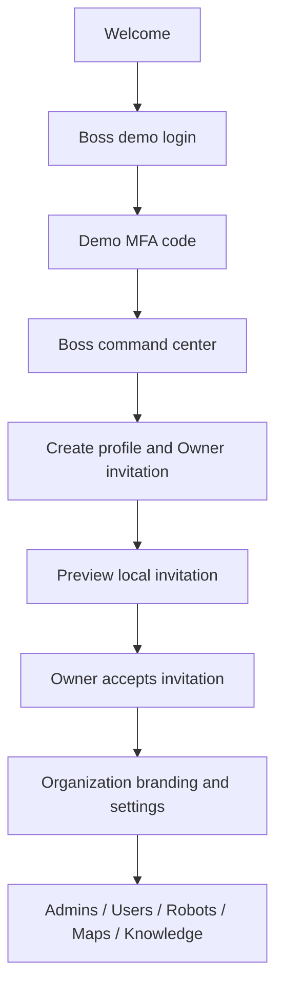
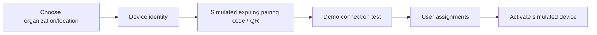
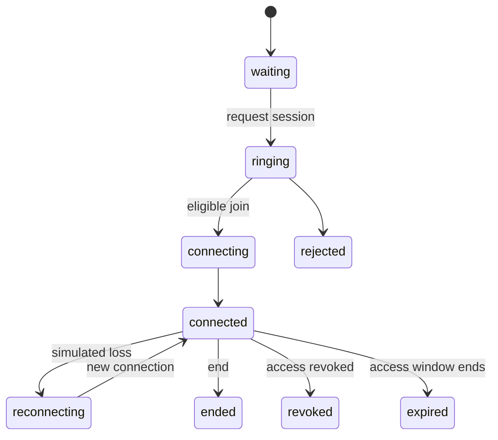
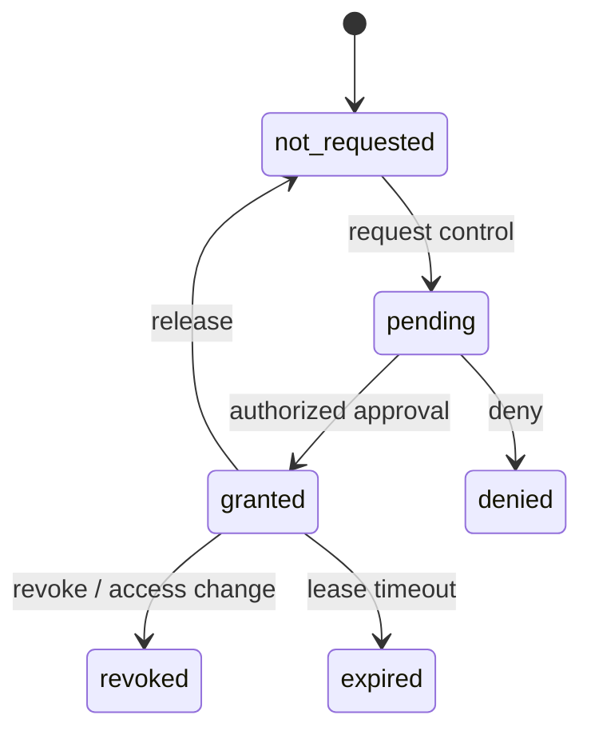

# Demo workflows

Use only the public fictitious accounts and demo data. Records are local to this browser profile and origin. Separate tabs can show different identities and synchronized local data; they do not represent internet messaging.

## Boss and new organization

Organization forms validate identity and a unique slug. Boss lifecycle actions require a confirmation for archive/delete and invalidate access when suspended. Open enters a tenant context; support access is explicit and audited. Quotas govern local create operations. Owner assignment/transfer respects the last-active-Owner rule.

## Owner, Admin, and User

Owners open their tenant, set branding/welcome/language/contacts/session policy, invite Admins and Users, and manage robots and published knowledge. Admins invite/edit ordinary Users, assign a tenant robot, and issue a session link. The Admin UI and provider deny all Admin/Owner mutation paths, even a forged generic edit payload. Users see assigned robots only and receive an explanation for an unauthorized route.

Membership changes take effect in local views, sessions, and driving grants. Search/filter/sort/page controls work on locally scoped rows. The invitations screen provides copy, QR, preview, regenerate, revoke, and copyable outbox text. No email is sent.

## Distinct public links

- `/#/o/:slug`: approved public organization tour.
- `/#/join/:token`: single-use local membership invitation.
- `/#/session/:token`: robot session invitation with access/capability checks.
- `/#/robot/:robotId/kiosk`: paired robot public kiosk.

Links derive from the actual origin and deployment base. Seeded public tours work in a fresh browser. A dynamically created token from another browser displays unavailable-demo-record information. Unknown, expired, revoked, used, wrong-recipient, and wrong-tenant states remain explicit; roles and credentials are not trusted from URL parameters.

## Pairing and operation

Wrong-tenant/expired pairing fails. Unpair/revoke/rotate are local demo lifecycle changes. Fault, offline, maintenance, charging, and in-call conditions remain separate robot fields. Reboot, update, and maintenance stop simulated motion before the operation and never resume it automatically.

Maps store validated PNG/JPEG/WebP blobs. Floors/versions/POIs can be updated; coordinate scale is explicit. Routes are visual demonstrations. Mission states are queued, running, paused, completed, canceled, and failed; changing state is not evidence of collision-free real navigation.

## Session, chat, and control

The default camera and remote participants are simulations. Call state is separate from drive permission. User–Admin and User–Robot chats persist locally with author, time, status/retry, and scoped conversation. Simulated replies identify themselves.

Hold-to-drive pointer/keyboard input moves only the simulator. Release, blur, hidden tab, navigation, stale telemetry, fault, loss, expiry, revoke, unsafe obstacle, and stop force zero velocity. Reconnection does not replay commands. After a stop/reset, new deliberate input is required. Stop acknowledgements distinguish requested, acknowledged, and unavailable.

## Media and kiosk

Camera/microphone and screen preview start only after a click and permission. Denial, cancel, unsupported APIs, ignored/late permission results, and ended tracks display recoverable UI. Preview is local and not transmitted. Stop, session end, logout, and unmount stop every media track. Fullscreen is optional and recoverable; browser fullscreen is not operating-system kiosk lockdown.

The public kiosk uses only paired tenant data. English/Persian/Turkish choices affect robot welcome and demo assistant, including RTL presentation. The assistant searches published tenant knowledge, cites sources, admits missing data, and offers local help tools. Speech recognition is not configured in this demo, including browsers that support it. Voice/listening controls show this unavailable state and offer typed input; supported text-to-speech is optional. Navigation tools request a mission through policy rather than issuing motor commands.

## Recovery

Invalid credentials show validation; suspended identities/organizations cannot enter management. Forgot password produces a copyable simulation rather than delivery confirmation. Demo MFA uses a public code. Expired tab login returns to demo sign-in. Storage faults show recovery/reset; quota failures retain form data. Reset asks confirmation, stops active simulation/media, clears local demo data, and restores deterministic fixtures. No real password reset, email, device pairing, or hardware action occurs.
